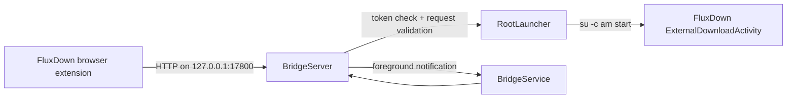

# FluxDown Bridge

[English](README.md) | [简体中文](README.zh-CN.md)

[](https://github.com/a268926268926-web/FluxDown-Bridge/actions/workflows/android.yml)
[](https://github.com/a268926268926-web/FluxDown-Bridge/releases)
[](LICENSE)

FluxDown Bridge is a small, root-assisted Android utility that lets the
[FluxDown browser extension](https://github.com/zerx-lab/FluxDown) send downloads
to **FluxDown for Android** through a local HTTP handoff.

It solves a narrow Android problem: Chrome-family browsers show an extra
confirmation before opening a custom protocol such as `fluxdown://`. The bridge
receives the extension's existing remote-server request on device, then uses
root to open FluxDown's `ExternalDownloadActivity` directly.

> **Scope:** this project is an independent loopback adapter. It does not patch
> FluxDown, the browser extension, Chromium, or Android.

## Features

- Listens only on `127.0.0.1:17800`; it never binds to Wi-Fi or the LAN.
- Uses a 256-bit random bearer token for authenticated endpoints.
- Supports single and batch download handoffs.
- Forwards filename, cookies, referrer, and request headers to FluxDown.
- Supports `http`, `https`, `ftp`, `magnet`, and `ed2k` links.
- Runs as an Android foreground service with an optional quiet notification.
- Can restore the service after reboot when the user has enabled it.
- Provides Material 3 Expressive UI, Android dynamic color, and safe edge-to-edge insets.
- Keeps FluxDown and the browser extension unchanged, so it does not add a
  second update-maintenance surface for either project.

## Requirements

| Requirement | Details |
| --- | --- |
| Android | Android 8.0 / API 26 or newer |
| FluxDown for Android | Must expose `com.fluxdown.app/.ExternalDownloadActivity` |
| Root | KernelSU, Magisk, or another manager that provides `su -c` |
| Browser | A Chromium-based browser capable of loading the FluxDown extension |
| Build tools | JDK 21, Android SDK Platform 37, Build Tools 37.0.0 |

Root is used only to launch FluxDown's exported intent without Chromium's
custom-protocol confirmation. The bridge does not request root for its HTTP
server or notification handling.

## Quick start

1. Install FluxDown for Android and the FluxDown browser extension.
2. Install the bridge APK from [Releases](https://github.com/a268926268926-web/FluxDown-Bridge/releases)
   or build it from source.
3. Open **FluxDown Bridge**, allow notifications, and tap **Test Root**.
4. Grant the Root manager permanent access when prompted.
5. Tap **Start Service**.
6. In the extension's remote-server settings, enter:
   - URL: `http://127.0.0.1:17800`
   - Token: copy the token shown in the bridge app
   - Download mode: `Always` or `Remote only`
7. Turn off the extension's **FluxDown custom protocol** option.
8. Start a normal HTTP or HTTPS download and confirm that FluxDown opens directly.

If the OEM stops foreground services in the background, set FluxDown Bridge to
**Unrestricted** under Android battery settings.

## How it works



The HTTP server runs inside a foreground service. For each accepted request it
constructs a `fluxdown://download?...` URI and launches FluxDown through `su`.
See [Architecture](docs/ARCHITECTURE.md) and [Protocol](docs/PROTOCOL.md) for the
full design and endpoint contract.

## Build from source

```bash
git clone https://github.com/a268926268926-web/FluxDown-Bridge.git
cd FluxDown-Bridge

export JAVA_HOME=/path/to/jdk-21
export ANDROID_HOME=/path/to/android-sdk
export ANDROID_SDK_ROOT="$ANDROID_HOME"

./build.sh
```

`build.sh` uses the checked-in Gradle wrapper and produces:

```text
app/build/outputs/apk/debug/app-debug.apk
```

Other useful commands:

```bash
./gradlew :app:assembleRelease
./gradlew :app:lintDebug
```

On networks where Aliyun Maven is faster, append
`-PuseAliyunMirror=true` to a Gradle command. Official Google/Maven Central
repositories remain the default.

The project does not ship a production signing key. GitHub releases built from
this repository are convenience builds signed with the Android debug
certificate; maintainers should configure their own private release signing
configuration before distributing a production APK.

## API summary

All download endpoints require:

```http
X-FluxDown-Token: <token shown in the Android app>
```

| Method | Path | Purpose | Authentication |
| --- | --- | --- | --- |
| `OPTIONS` | any | CORS preflight | No |
| `GET` | `/ping` | Service liveness and version | No |
| `GET` | `/api/v1/info` | Authenticated readiness check | Yes |
| `POST` | `/download` | Hand off one item | Yes |
| `POST` | `/download/batch` | Hand off multiple items | Yes |

Minimal request:

```bash
curl http://127.0.0.1:17800/download \
  -H 'Content-Type: application/json' \
  -H 'X-FluxDown-Token: YOUR_TOKEN' \
  --data '{"url":"https://example.com/file.zip","filename":"file.zip"}'
```

The complete request and response schema is documented in
[docs/PROTOCOL.md](docs/PROTOCOL.md).

## Security model

- The listener is bound to the IPv4 loopback interface only.
- The token is generated with `SecureRandom`, stored in app-private
  `SharedPreferences`, and compared in constant time.
- Request headers are capped at 32 KiB and request bodies at 2 MiB.
- Sockets use a 10-second read timeout and the root launch command has a
  20-second timeout.
- Cookies and request headers are forwarded as part of the handoff URI because
  FluxDown needs them for authenticated downloads.
- Root access is powerful. Review the source and install only builds from a
  source or maintainer you trust.

Do not expose the port through a reverse proxy, `adb reverse`, port forward, or
LAN relay. The API is designed for the browser and FluxDown instance on the same
Android device.

Please report vulnerabilities according to [SECURITY.md](SECURITY.md).

## Compatibility and limitations

- The bridge itself supports Android 8.0 through Android 17 (API 26 through
  API 37). Versions newer than API 37 are not yet validated.
- The browser host has its own minimum. The Helium 155 build used during
  development requires Android 10 / API 29 or newer.
- The bridge depends on FluxDown's current package name and
  `ExternalDownloadActivity` component.
- Separate `audioUrl` tracks are rejected because the `fluxdown://` handoff URI
  cannot merge them.
- Some vendor ROMs aggressively stop foreground services. Battery
  unrestricted mode may be required.
- The browser extension must be able to reach the same device's loopback
  interface. Remote desktop browsers, phones used through ADB port forwarding,
  and browsers in another network namespace are out of scope.
- This repository has build and lint verification. Device behavior varies by
  FluxDown version, Android release, Root implementation, and OEM policy.

## Troubleshooting

**The extension says “not connected”**

1. Confirm the bridge notification says it is running.
2. Open `http://127.0.0.1:17800/ping` from a browser on the same device.
3. Re-copy the token from the app and test `/api/v1/info`.
4. Disable battery optimization for FluxDown Bridge.
5. Restart the service and test again.

**The service starts but FluxDown does not open**

1. Run **Test Root** in the bridge app.
2. Confirm `com.fluxdown.app` and `.ExternalDownloadActivity` exist in the
   installed FluxDown build.
3. Review the Root manager's grant and log pages.
4. Ensure the extension's custom-protocol option is disabled.

**It works until the screen stays off for a while**

Enable unrestricted battery use, keep the foreground notification visible, and
check whether the ROM has a separate background-start or autostart permission.

For request-level diagnostics that contain no URLs, cookies, tokens, or bodies:

```bash
adb logcat -s FluxDownBridge
```

## Contributing

Bug reports and focused pull requests are welcome. Read
[CONTRIBUTING.md](CONTRIBUTING.md) before opening a PR. For a behavior change,
include the affected browser, FluxDown version, Android release, Root provider,
and relevant sanitized logs.

## License

This project is available under the [MIT License](LICENSE).
