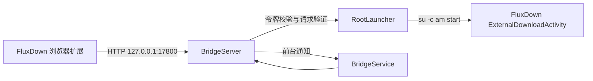

# FluxDown Bridge

[English](README.md) | [简体中文](README.zh-CN.md)

[](https://github.com/a268926268926-web/FluxDown-Bridge/actions/workflows/android.yml)
[](https://github.com/a268926268926-web/FluxDown-Bridge/releases)
[](LICENSE)

FluxDown Bridge 是一个小型、依赖 Root 的 Android 工具，用于把
[FluxDown 浏览器扩展](https://github.com/zerx-lab/FluxDown) 的下载请求，通过本机
HTTP 回环接口交给 **FluxDown Android 版**。

它只解决一个很具体的问题：Chromium 系浏览器在打开 `fluxdown://` 自定义协议前，
通常会再显示一次确认页。Bridge 在手机内接收扩展现有的“远程服务器”请求，再通过
Root 直接启动 FluxDown 的 `ExternalDownloadActivity`。

> 本项目是独立的回环适配器，不修改 FluxDown、浏览器扩展、Chromium 或 Android。

## 功能

- 只监听 `127.0.0.1:17800`，不绑定 Wi-Fi 或局域网。
- 使用 `SecureRandom` 生成 256 位随机访问令牌。
- 支持单条和批量投递，批量开始前统一校验参数。
- 显示服务实际启动、监听、停止和失败状态，无需轮询。
- 令牌原地更新，更新时不重启监听。
- 转发文件名、Cookie、Referer 和请求头。
- 支持 `http`、`https`、`ftp`、`magnet` 与 `ed2k`。
- 以前台服务运行，支持静默通知和开机恢复。
- 使用 Material 3 Expressive、Android 动态取色和安全区域边到边布局。
- 使用纯 Kotlin 实现，不引入 JNI 或原生 ABI 构建矩阵。
- 不修改 FluxDown 和浏览器扩展，避免增加两套更新维护成本。

## 环境要求

| 项目 | 要求 |
| --- | --- |
| Android | Android 8.0 / API 26 或更高 |
| FluxDown Android | 必须包含 `com.fluxdown.app/.ExternalDownloadActivity` |
| Root | KernelSU、Magisk 或其他可提供 `su -c` 的管理器 |
| 浏览器 | 能加载 FluxDown 扩展的 Chromium 系浏览器 |
| 构建 | JDK 21、Android SDK Platform 37、Build Tools 37.0.0 |

Root 只用于跳过 Chromium 的自定义协议确认页，HTTP 服务和通知逻辑本身不调用 Root。

## 快速开始

1. 安装 FluxDown Android 版与 FluxDown 浏览器扩展。
2. 从 [Releases](https://github.com/a268926268926-web/FluxDown-Bridge/releases)
   安装 Bridge，或从源码构建。
3. 打开 **FluxDown Bridge**，按需选择是否显示通知，然后点击 **测试 Root**。
4. 在 Root 管理器中永久授权。
5. 点击 **启动服务**。
6. 在扩展的“远程服务器”设置中填写：
   - 地址：`http://127.0.0.1:17800`
   - 令牌：从 App 中复制
   - 投递模式：`Always` 或 `Remote only`
7. 关闭扩展里的 **FluxDown 自定义协议**。
8. 打开一个正常 HTTP/HTTPS 下载链接，确认 FluxDown 直接打开。

如果系统在后台停止了前台服务，请在电池设置中把 FluxDown Bridge 设为
**无限制**。

## 工作方式



详细设计见 [架构说明](docs/ARCHITECTURE.md) 和 [协议文档](docs/PROTOCOL.md)。

## 从源码构建

```bash
git clone https://github.com/a268926268926-web/FluxDown-Bridge.git
cd FluxDown-Bridge

export JAVA_HOME=/path/to/jdk-21
export ANDROID_HOME=/path/to/android-sdk
export ANDROID_SDK_ROOT="$ANDROID_HOME"

./build.sh
```

产物位于：

```text
app/build/outputs/apk/debug/app-debug.apk
```

其他常用命令：

```bash
./gradlew :app:assembleRelease
./gradlew :app:lintDebug
```

如果所在网络访问阿里云 Maven 更快，可在 Gradle 命令后添加
`-PuseAliyunMirror=true`。默认仓库仍是 Google Maven 与 Maven Central。

官方 Release 沿用原有维护者证书，已安装用户可以覆盖升级。证书名称仍为
`Android Debug`，但密钥已经独立保存在仓库外并备份；其他机器生成的 Debug 证书
不是同一身份，不能用来覆盖官方安装包。

发布时通过 `FLUXDOWN_SIGNING_PROPERTIES` 指定仓库外的属性文件，包含
`storeFile`、`storePassword`、`keyAlias`、`keyPassword`。未配置时，本地和 CI
使用各自的 Debug 密钥，仅用于测试。

可用 `./gradlew :app:testDebugUnitTest` 运行缓冲读取、令牌热更新、空闲连接和
批量校验回归；测试不会启动真实下载或请求 Root。

## API 概览

下载接口需要请求头：

```http
X-FluxDown-Token: <App 中显示的令牌>
```

| 方法 | 路径 | 用途 | 鉴权 |
| --- | --- | --- | --- |
| `OPTIONS` | 任意 | CORS 预检 | 否 |
| `GET` | `/ping` | 服务存活与版本 | 否 |
| `GET` | `/api/v1/info` | 鉴权后的就绪检查 | 是 |
| `POST` | `/download` | 投递单个项目 | 是 |
| `POST` | `/download/batch` | 投递多个项目 | 是 |

最小请求示例：

```bash
curl http://127.0.0.1:17800/download \
  -H 'Content-Type: application/json' \
  -H 'X-FluxDown-Token: YOUR_TOKEN' \
  --data '{"url":"https://example.com/file.zip","filename":"file.zip"}'
```

完整字段和返回格式见 [协议文档](docs/PROTOCOL.md)。

## 安全模型

- 服务只绑定 IPv4 回环地址。
- 令牌保存在应用私有 `SharedPreferences` 中，并使用常量时间比较。
- 请求头上限 32 KiB，请求体上限 2 MiB。
- Socket 读取超时为 3 秒，Root 启动命令超时为 20 秒。
- Cookie 和请求头会随投递 URI 转发给 FluxDown，因为认证下载需要这些信息。
- Root 权限具有较高风险，请只安装来自可信源码或维护者的 APK。

不要通过反向代理、`adb reverse`、端口转发或局域网中继暴露该端口。接口面向同一台
Android 设备上的浏览器和 FluxDown。

安全问题请按 [SECURITY.md](SECURITY.md) 报告。

## 兼容范围与限制

- Bridge 本身支持 Android 8.0 至 Android 17（API 26 至 API 37），更高的 API
  版本尚未验证。
- 浏览器宿主有自己的最低版本。开发时使用的 Helium 155 要求 Android 10 /
  API 29 或更高。
- 依赖 FluxDown 当前的包名和 `ExternalDownloadActivity` 组件。
- 无法合并独立 `audioUrl` 音轨，因此该形式会被拒绝。
- 部分厂商系统会强制停止前台服务，需要关闭电池限制。
- 浏览器必须能访问同一设备的回环接口；桌面远程浏览器和跨网络命名空间场景不在支持范围。
- 当前仓库已验证构建和 lint；真实行为仍与 FluxDown 版本、Android、Root 实现和厂商策略有关。

## 常见问题

**扩展显示“未连接”**

1. 查看 Bridge 内的实际监听状态；启动失败时会显示原因。
2. 在同一台手机的浏览器打开 `http://127.0.0.1:17800/ping`。
3. 重新复制令牌并测试 `/api/v1/info`。
4. 关闭 FluxDown Bridge 的电池优化。
5. 重启服务后再次测试。

**服务正常，但 FluxDown 没有打开**

1. 在 App 内运行 **测试 Root**。
2. 确认安装包中存在 `com.fluxdown.app` 和 `.ExternalDownloadActivity`。
3. 检查 Root 管理器的授权和使用记录。
4. 确认扩展内的“自定义协议”已关闭。

**熄屏一段时间后失效**

将 App 设为无限制电池使用，保持前台通知，并检查 ROM 是否还有独立的自动启动或后台启动权限。

**关闭通知后感觉变得不稳定**

通知是可选项。如果关闭应用通知或通知渠道后出现间歇断连，可以先把标准通知
恢复一段时间做对比。仅凭相关性不能断定系统降低了进程优先级。

如需查看不包含 URL、Cookie、令牌和请求体的请求级日志：

```bash
adb logcat -s FluxDownBridge
```

## 贡献

欢迎提交问题和范围明确的 Pull Request。提交前请阅读
[CONTRIBUTING.md](CONTRIBUTING.md)。报告下载接管问题时，请提供浏览器、
FluxDown 版本、Android 版本、Root 类型和已脱敏日志。

## 许可证

本项目使用 [MIT License](LICENSE)。
