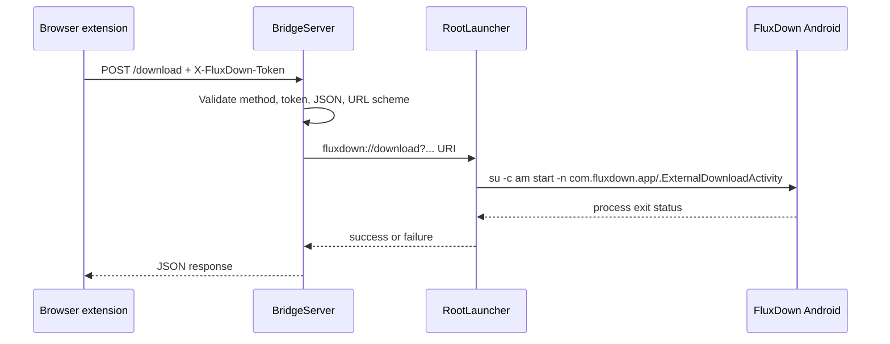

# Architecture

## Context

FluxDown's browser extension can hand downloads to a remote FluxDown instance
over HTTP. On Android, Chromium-based browsers still show an additional
confirmation when a page or extension tries to open a custom protocol.

FluxDown Bridge places a small remote endpoint on the Android device and uses
Root to start FluxDown's exported activity directly. The browser extension and
FluxDown APK remain unchanged.

## Components

| Component | Responsibility |
| --- | --- |
| `MainActivity` | Material 3 Expressive control surface, token management, notification preference, Root test |
| `BridgeService` | Foreground service lifecycle, notification channels, and service restart policy |
| `BridgeServer` | Loopback HTTP server, token checks, request parsing, CORS, and URI construction |
| `RootLauncher` | Runs `su -c` commands with a timeout and opens `ExternalDownloadActivity` |
| `BridgePrefs` | App-private token, enabled state, and quiet-notification preference |
| `BootReceiver` | Restarts the service after boot only when the user left it enabled |

## Implementation language

The Android application intentionally uses Kotlin plus a small Java adapter:

- Kotlin handles Compose UI, lifecycle, service controls, preferences, and
  platform integration.
- Java implements the compact HTTP server and root-process adapter without an
  additional framework or asynchronous runtime.

Rust is not used in the bridge itself. A Rust rewrite would still require the
JVM/Compose process for Android UI and service APIs, while adding JNI/NDK build
variants, binary size, lifecycle bridging, and crash-debugging complexity for a
workload that handles only a few short loopback requests.

Rust becomes appropriate if FluxDown Bridge later grows a portable, CPU-heavy
download engine, protocol parser, hashing pipeline, or shared desktop/mobile
core. That component should then be isolated behind a stable native interface;
the Android service and notification layer should remain Kotlin.

## Request flow



The HTTP request finishes after the `am start` command returns. A successful
response means Android accepted the launch request; completion of the actual
download remains FluxDown's responsibility.

## Server lifecycle

1. The user enables the service from the UI.
2. `BridgeService` calls `startForeground` before accepting traffic.
3. `BridgeServer` binds to `127.0.0.1:17800`.
4. A fixed four-thread executor handles client connections.
5. `onDestroy` closes the listening socket and interrupts worker threads.
6. `START_STICKY` allows Android to recreate the service when appropriate.

The service never binds to `0.0.0.0` and has no LAN discovery mechanism.

## Intent handoff

The generated URI has this shape:

```text
fluxdown://download?url=...&filename=...&cookies=...&referrer=...&headers=...
```

Every component is URL-encoded as UTF-8. A literal single quote is encoded before
the URI is included in the shell command, and the complete URI is quoted inside
the root command.

## Security boundaries

- The bearer token is a 256-bit `SecureRandom` value encoded as unpadded Base64URL.
- `MessageDigest.isEqual` performs constant-time token comparison.
- Request headers are limited to 32 KiB and bodies to 2 MiB.
- Supported schemes are allowlisted.
- Each socket has a 10-second read timeout.
- Root process execution is serialized and limited to 20 seconds.
- Backups are disabled in the manifest.
- The foreground notification provides a visible reminder while the server runs.

## Deliberate trade-offs

- **Local HTTP instead of native messaging:** the Android Chromium environment
  does not offer the same desktop native-messaging bridge.
- **Root for launch:** this avoids maintaining a patched FluxDown APK or Xposed
  module and preserves FluxDown's normal update path.
- **Small server implementation:** only the routes used by the extension are
  implemented, which keeps the attack surface and dependency count low.
- **No remote multi-device proxy:** exposing the service beyond loopback would
  change the trust model and require TLS, user provisioning, and stronger
  authorization.
